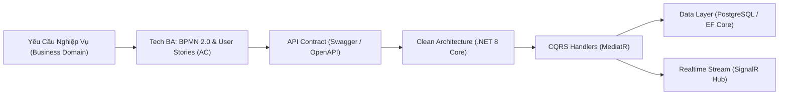

<div align="center">

# 🌿 Huỳnh Anh Khoa | Software Engineer & Technical Business Analyst
### High-Performance .NET Backend & Domain-Driven Business Analysis

[](https://anhkhoadev9.github.io/Portfolioo/)
[](https://github.com/anhkhoadev9)
[](mailto:huynhankhoa30042019@gmail.com)

<p align="center">
  
  
  
  
  
  
</p>

*Trang web Portfolio cá nhân chuyên nghiệp được thiết kế theo phong cách tối giản, chân thực và thực chiến với hệ thống nhận diện **Nordic Sage & Carbon** (Xanh rêu trầm trên nền than chì), giải quyết bài toán cốt lõi: **Kết nối trọn vẹn nghiệp vụ doanh nghiệp với kiến trúc backend hiệu năng cao.***

</div>

---

## 📌 Mục Lục (Table of Contents)
1. [Giới Thiệu & Triết Lý Kỹ Thuật](#-giới-thiệu--triết-lý-kỹ-thuật)
2. [Hồ Sơ Năng Lực Kép (Dev + Tech BA)](#-hồ-sơ-năng-lực-kép-dual-competency)
3. [Các Dự Án Trọng Tâm (Case Studies)](#-các-dự-án-trọng-tâm-case-studies)
4. [Nguyên Tắc Làm Việc Kỹ Sư](#-nguyên-tắc-làm-việc-kỹ-sư)
5. [Cấu Trúc Mã Nguồn & Thiết Kế](#-cấu-trúc-mã-nguồn--thiết-kế)
6. [Hướng Dẫn Chạy Cục Bộ (Local Setup)](#-hướng-dẫn-chạy-cục-bộ-local-setup)
7. [Hướng Dẫn Triển Khai (Deployment)](#-hướng-dẫn-triển-khai-deployment)
8. [Thông Tin Liên Hệ](#-thông-tin-liên-hệ)

---

## 💡 Giới Thiệu & Triết Lý Kỹ Thuật

Nhiều dự án phần mềm gặp trục trặc không phải vì công nghệ yếu, mà vì **lập trình viên viết mã trước khi hiểu bản chất bài toán nghiệp vụ**, dẫn đến việc phải tái cấu trúc cơ sở dữ liệu và API nhiều lần, gây lãng phí chi phí và trễ tiến độ.

Với sự kết hợp song hành giữa **Backend .NET Developer** và **Technical Business Analyst**, mục tiêu của tôi là:
- **Làm rõ yêu cầu từ gốc**: Phân tích quy trình (BPMN), định nghĩa rõ ràng Acceptance Criteria và vẽ luồng dữ liệu trước khi viết dòng code đầu tiên.
- **Hiện thực hóa chuẩn mực**: Áp dụng kiến trúc Clean Architecture, CQRS (MediatR), thiết kế cơ sở dữ liệu chuẩn hóa và xây dựng API rành mạch, bảo mật và dễ mở rộng.



---

## ⚡ Hồ Sơ Năng Lực Kép (Dual Competency)

| Lĩnh Vực | Kỹ Năng / Công Nghệ Trọng Tâm | Giá Trị Thực Tế Mang Lại |
| :--- | :--- | :--- |
| **Backend .NET** | C# 12, .NET 8 LTS, ASP.NET Core Web API, Minimal API, Blazor (SSR & WASM), SignalR, EF Core, Dapper | Xây dựng dịch vụ API hiệu năng cao, module hóa rành mạch, xử lý tác vụ thời gian thực qua WebSockets |
| **Kiến Trúc & Design** | Clean Architecture (4-layer), CQRS Pattern (MediatR), Repository & Unit of Work, SOLID, Event-Driven | Mã nguồn phân tầng độc lập, triệt tiêu phụ thuộc vòng, kiểm thử tự động dễ dàng và thuận tiện cho onboarding |
| **Cơ Sở Dữ Liệu & DevOps** | PostgreSQL, MS SQL Server, Redis In-Memory Cache, Docker, Docker Compose, GitHub Actions CI/CD | Tối ưu hóa chỉ mục (Indexing), truy vấn dữ liệu hiệu quả, container hóa môi trường phát triển đồng nhất |
| **Technical BA** | BPMN 2.0, UML Sequence & Use Case, SRS / BRD, User Stories & Acceptance Criteria, Swagger/Postman | Chuyển đổi ngôn ngữ người dùng thành tài liệu kỹ thuật chuẩn xác; thiết kế API Spec để Frontend làm việc song song |

---

## 🚀 Các Dự Án Trọng Tâm (Case Studies)

### 1. Queue Management System (Hệ thống bốc số & điều phối quầy thông minh)
- **Bài toán**: Tình trạng ùn ứ, chen lấn và mất thứ tự phục vụ tại các phòng giao dịch, quầy tiếp nhận hoặc phòng khám.
- **Giải pháp**: Xây dựng hệ thống bốc số tự động. Nhân viên tại quầy ấn nút "Gọi số tiếp theo", màn hình lớn ngoài sảnh chờ sẽ tự động cập nhật số đang phục vụ thông qua **SignalR WebSocket** tức thì mà không cần tải lại trang.
- **Kiến trúc & Kỹ thuật**:
  - **Clean Architecture 4 tầng**: Domain, Application, Infrastructure, WebAPI.
  - **CQRS với MediatR**: Tách biệt rành mạch giữa Command tạo vé/chuyển trạng thái và Query lấy danh sách quầy chờ.
  - **Lưu trữ**: PostgreSQL quản lý vòng đời vé (`Chờ` $\rightarrow$ `Đang phục vụ` $\rightarrow$ `Hoàn tất`).
  - **Docker Compose**: Đóng gói backend, database và hub realtime sẵn sàng triển khai.

---

### 2. Project M: Memeries Vault (Không gian lưu trữ kỷ niệm riêng tư cho cặp đôi)
> *Trích xuất từ mã nguồn dự án thực tế `TC LoveApp / Memeries`.*
- **Bài toán**: Nền tảng mạng xã hội và kho lưu trữ kỷ niệm dành riêng cho 2 người, đòi hỏi mức độ riêng tư và an toàn dữ liệu tuyệt đối (Zero-Data Leak), chống lộ liên kết hình ảnh và ngăn chặn tấn công truy cập chéo (IDOR).
- **Giải pháp**: Ứng dụng kiến trúc **Feature-Driven Architecture** kết hợp nền tảng **Supabase BaaS (PostgreSQL + RLS)** và **WebRTC Peer-to-Peer**.
- **Kiến trúc & Kỹ thuật Thực Chiến**:
  - **PostgreSQL Row Level Security (RLS)**: Chính sách bảo mật cấp hàng nghiêm ngặt trực tiếp trong Database: chỉ 2 tài khoản có `auth.uid() = partner_id` mới có quyền truy xuất dữ liệu của nhau.
  - **Private Storage & Signed URLs (TTL 60s)**: Hình ảnh/video nhạy cảm lưu trong Private Bucket; chỉ cấp phát link truy cập tạm thời có chữ ký điện tử tự hủy sau thời gian ngắn.
  - **In-Memory Sliding Window Rate Limiter**: Thuật toán trượt thời gian với cấu trúc $O(1)$ Map lookup, bảo vệ các endpoint nhạy cảm (Upload, Call Signaling, Push) khỏi nguy cơ spam và brute-force.
  - **WebRTC P2P Call**: Cuộc gọi video và thoại kết nối ngang hàng mã hóa đầu cuối (E2EE), không qua media server trung gian.
  - **Security Audit Logs (`security_logs`)**: Bảng ghi vết an ninh thời gian thực (IP, Actor, Endpoint, Severity) để giám sát các hành vi bất thường.

---

### 3. Blazor Enterprise App (Ứng dụng quản trị doanh nghiệp nội bộ)
- **Bài toán**: Doanh nghiệp cần công cụ quản lý danh mục sản phẩm, nhân sự và đơn hàng nội bộ với giao diện đồng nhất, phân quyền theo vai trò và tốc độ phản hồi nhanh.
- **Giải pháp**: Phát triển bằng **Blazor Web App (.NET 8)** kết hợp Server-Side Rendering (SSR) cho tốc độ tải trang ban đầu và WebAssembly (WASM) cho các bảng tương tác dữ liệu cao.
- **Kiến trúc & Kỹ thuật**:
  - C# đồng nhất từ giao diện (Razor Components) đến tầng xử lý dữ liệu.
  - Entity Framework Core với MS SQL Server, tối ưu câu lệnh LINQ và phân trang động.
  - Kiểm tra dữ liệu phía máy chủ bằng FluentValidation.

---

## 🛠️ Nguyên Tắc Làm Việc Kỹ Sư

1. **Hiểu đúng trước khi gõ code**: Mất 1 giờ làm rõ User Story và Acceptance Criteria sẽ tiết kiệm 1 tuần sửa lại cấu trúc Database. Luôn chủ động đặt câu hỏi khi bài toán chưa rõ ràng.
2. **Code dễ đọc hơn code "thông minh"**: Code viết ra là để đồng đội đọc và bảo trì. Luôn ưu tiên đặt tên biến, hàm tường minh, tuân thủ Clean Architecture thay vì viết các đoạn code tắt khó hiểu.
3. **Cầu tiến và đón nhận phản hồi**: Công nghệ liên tục phát triển. Khi gặp lỗi hoặc nhận review mã nguồn, luôn tìm hiểu nguyên nhân gốc rễ (Root Cause) để cải thiện và không lặp lại lỗi cũ.

---

## 📁 Cấu Trúc Mã Nguồn & Thiết Kế

Toàn bộ ứng dụng portfolio được tối ưu hóa trong **1 file phân phối duy nhất** (`index.html`), không cần cài đặt Node.js hay qua build step phức tạp:

```text
PORFOLIO/
├── index.html       # Toàn bộ mã nguồn HTML5, Tailwind CSS, Lucide Icons, Vanilla JS
├── README.md        # Tài liệu đặc tả kỹ thuật dự án
└── .gitignore       # Cấu hình bỏ qua các tệp không cần thiết
```

### 🎨 Hệ Thống Thiết Kế (Design System)
- **Phong cách**: Minimalist, Dark Theme chuẩn kỹ thuật hiện đại.
- **Màu chủ đạo (Nordic Sage & Carbon)**:
  - Nền than chì sâu: `#0b0f0d` / `#111714`
  - Bề mặt card: `#1c2822` (viền `#22332a`)
  - Màu nhấn kỹ thuật: `#10b981` (Emerald / Sage)
- **Typography**: Google Fonts **Inter** (văn bản) & **JetBrains Mono** (mã nguồn kiến trúc).

---

## 💻 Hướng Dẫn Chạy Cục Bộ (Local Setup)

Bạn có thể chạy thử trang web ngay trên máy tính mà không cần cài đặt dependencies:

### Cách 1: Sử dụng Python Server
```bash
# Di chuyển vào thư mục dự án
cd PORFOLIO

# Khởi chạy server tại cổng 3000
python -m http.server 3000
```
Mở trình duyệt tại: `http://localhost:3000`

### Cách 2: Sử dụng VS Code Live Server
- Mở thư mục bằng VS Code.
- Nhấp chuột phải vào file `index.html` và chọn **"Open with Live Server"**.

### Cách 3: Mở trực tiếp
- Nhấp đúp chuột vào file `index.html` trên máy tính để mở bằng trình duyệt (Chrome, Edge, Firefox).

---

## 🌐 Hướng Dẫn Triển Khai (Deployment)

### Triển khai lên GitHub Pages (Đang chạy thực tế)
1. Đẩy mã nguồn lên GitHub:
   ```bash
   git add .
   git commit -m "feat: update portfolio"
   git push origin main
   ```
2. Truy cập: **Settings** $\rightarrow$ **Pages** trên repository GitHub.
3. Tại mục **Build and deployment**:
   - **Source**: `Deploy from a branch`
   - **Branch**: `main` / `/(root)`
   - Nhấn **Save**.
4. Trang web sẽ trực tuyến tại: **`https://anhkhoadev9.github.io/Portfolioo/`**

### Triển khai lên Vercel
1. Đăng nhập [vercel.com](https://vercel.com/) bằng tài khoản GitHub.
2. Chọn **Add New...** $\rightarrow$ **Project** $\rightarrow$ Chọn repository `Portfolioo`.
3. Nhấn **Deploy** (giữ thiết lập mặc định).

---

## 📬 Thông Tin Liên Hệ

- **Họ và tên**: Huỳnh Anh Khoa
- **Chức danh**: Backend .NET Developer & Technical Business Analyst
- **Địa điểm**: TP. Hồ Chí Minh, Việt Nam
- **Email**: [huynhankhoa30042019@gmail.com](mailto:huynhankhoa30042019@gmail.com)
- **GitHub**: [github.com/anhkhoadev9](https://github.com/anhkhoadev9)
- **Học vấn**: Cử nhân Kỹ thuật Phần mềm (Software Engineering) - Đại học Đồng Tháp

---

<div align="center">
  <sub>Thiết kế &amp; phát triển với tinh thần kỹ thuật thực chiến bởi Huỳnh Anh Khoa &bull; 2026</sub>
</div>
